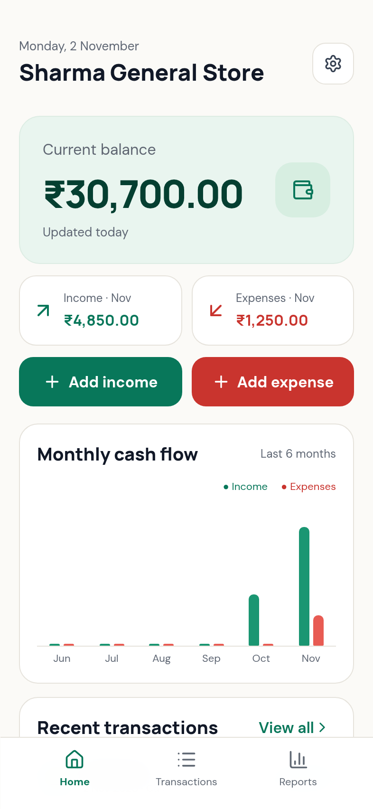
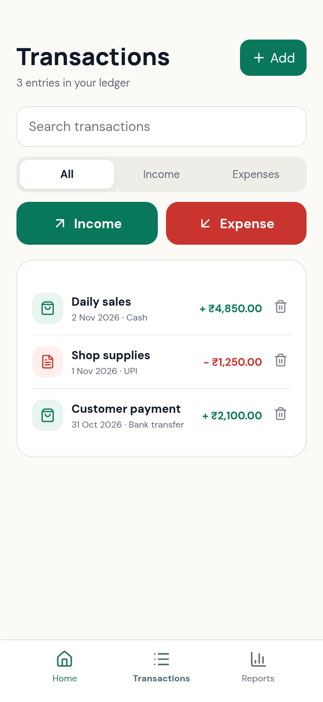
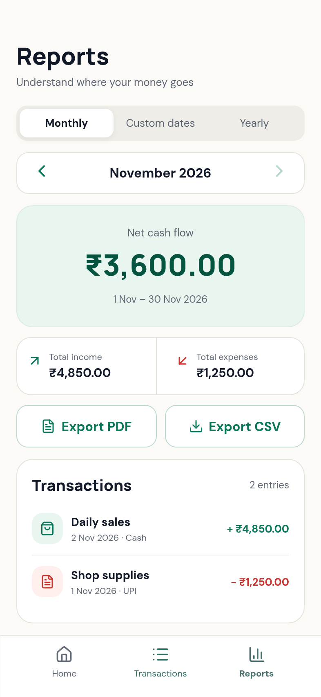

# Daily Ledger

Daily Ledger is a simple offline Android bookkeeping app for small shops. Record income and expenses, check your balance, and keep your ledger on your own device—no account or internet connection is required.

[](https://github.com/Priyank910/Daily-Ledger/releases/latest/download/Daily-Ledger-Android.apk)

Requires Android 7.0 or newer. Android may ask you to allow installation from your browser or file manager.

## Screenshots

These screenshots show sample data from the app.

| Home | Transactions | Reports |
|:---:|:---:|:---:|
|  |  |  |

## What you can do

- Set up your shop name and opening balance.
- Record income and expenses with a date, payment method, and optional note.
- Check your current balance and monthly cash flow.
- Search and filter transactions; review monthly, custom-date, and yearly reports.
- Export PDF and CSV reports using Android's share menu.
- Export and restore a complete offline JSON backup from **Home → Settings → Backup and restore**.

Monthly totals update automatically when the month changes. Your balance carries forward, and previous transactions remain in your ledger.

## Back up and restore

1. Open **Home → Settings → Backup and restore**, then tap **Export backup**.
2. Choose a safe location outside Daily Ledger, such as your Downloads folder or another device. The backup contains private financial information.
3. To restore, choose **Restore backup** in Settings, or on the first setup screen of a fresh installation. Check the shop name and transaction count before confirming replacement.

**Keep a copy outside the app before uninstalling or changing phones.** Uninstalling the app or clearing its data removes its local ledger. PDF and CSV reports are for reading and analysis; they are not restore files in v2.2.2. The v2.2.2 JSON backup format is separate from the backup data embedded in v2.1.0 reports and cannot restore those older PDF/CSV files.

## Installing and updating

Download `Daily-Ledger-Android.apk` from the [latest release](https://github.com/Priyank910/Daily-Ledger/releases/latest). To install an update over an existing app, Android requires the same application ID and signing key and a newer version code. The v1.0.0 and v2.1.0 GitHub APKs used different debug keys from the new release key, so they cannot be updated directly to v2.2.2. Uninstalling an older version deletes its local data; save your records first. Future releases signed with the same release key can update v2.2.2 without uninstalling, while preserving compatible local data.

## Development

Prerequisites: Node.js 22+, Java 21, and the Android SDK.

```bash
npm ci
npm run dev
node --test tests/*.test.mjs
npm run android:sync
cd android
./gradlew assembleDebug
```

The debug APK is at `android/app/build/outputs/apk/debug/app-debug.apk`. Debug builds use a different key from the release and cannot update the release APK.

### Release signing

The GitHub Actions release workflow requires repository secrets `LEDGER_KEYSTORE_BASE64` (the base64-encoded release keystore) and `LEDGER_KEYSTORE_PASSWORD`. The key alias is `daily-ledger`; the key and keystore use the same password. Keep the keystore and password in secure storage, keep a recovery copy, and never commit either to Git. The workflow fails when the secrets are missing rather than publishing a debug-signed APK. Increment Android's `versionCode` for every update. A version tag triggers the release workflow after signing secrets have been configured.

## Built with

React, TypeScript, Vite, Capacitor, jsPDF, and Android Gradle tooling.
